# 🗺️ Roadmap de Modelos Especializados y Próximas Iteraciones (`roadmap.md`)

> **Estado del Sistema:** Producción activa en `m27_v5` (198,423 partidos, Test AUC 0.6708, WR 75.61% en $P \ge 0.68$, ROI @ 1.40: +5.85%).
> **Objetivo:** Desacoplar ligas y situaciones con reglamentos o dinámicas anómalas en **modelos especialistas dedicados**, evitando que contaminen el modelo general FIBA e iterando de manera ordenada liga por liga.

---

## 📋 Arquitectura General del Roadmap

```mermaid
flowchart TD
    M27_V5["🏀 m27_v5 (Campeón Global FIBA 10m)<br/>En Producción (198k Partidos)"]
    
    subgraph Fase1["Fase 1: Optimización de Base"]
        V5_1["m27_v5_1 Lean<br/>Poda de 12 features ruidosas (25f nucleares)"]
    end

    subgraph Fase2["Fase 2: Modelos Especialistas por Liga (12m y Ligas Particulares)"]
        M34_NBA["🇺🇸 m34_nba (NBA 12m)<br/>23,526 partidos | Min 34.5 | Load Mgmt"]
        M34_CBA["🇨🇳 m34_cba (China CBA 12m)<br/>6,309 partidos | Cuota Extranjeros en Q4"]
        M34_PBA["🇵🇭 m34_pba (Filipinas PBA 12m)<br/>2,650 partidos | Copas / Línea de 4 Puntos"]
        M30_NCAA["🎓 m30_ncaa (NCAA College)<br/>4,811 partidos | 2 Mitades 20m | Reloj 30s"]
        M27_EL["🇪🇺 m27_euroleague_sharp<br/>3,754 partidos | Rotaciones 12 hombres | Doble Jornada"]
        M27_NBL["🇦🇺 m27_nbl_fastpace<br/>10,459 partidos | 10m Ritmo Transición USA"]
        M27_SA["🌎 m27_south_america<br/>7,802 partidos | LNB Argentina & Brasil NBB | Factor Cancha Extremo"]
        M27_WOMEN["👩 m27_women_pro<br/>9,681 partidos | WNBA & LF Endesa | Alta Retención Q3"]
    end

    subgraph Fase3["Fase 3: Especialistas Situacionales"]
        M27_PLAYOFFS["🏆 m27_playoffs / finals<br/>Series Eliminatorias | Rotación Corta | Under Q4"]
        M27_COLD_START["❄️ m27_cold_start<br/>Jornadas 1-4 | Roster Turnover | Bayes Shrinkage"]
    end

    subgraph Fase4["Fase 4: Re-evaluación Arquitectural a Gran Escala (200k)"]
        DL_V2["🧠 dl_v2_tabular<br/>TabNet, FT-Transformer & Entity Embeddings (200k samples)"]
    end

    subgraph Fase5["Fase 5: Ingesta Focalizada de Datos"]
        BACKFILL["📦 Backfill Prioritario<br/>Euroleague, France Pro A, Eurocup PBP (2024-2025)"]
    end

    M27_V5 --> V5_1
    M27_V5 --> M34_NBA
    M27_V5 --> M34_CBA
    M27_V5 --> M34_PBA
    M27_V5 --> M30_NCAA
    M27_V5 --> M27_EL
    M27_V5 --> M27_NBL
    M27_V5 --> M27_SA
    M27_V5 --> M27_WOMEN
    M27_V5 --> M27_PLAYOFFS
    M27_V5 --> M27_COLD_START
    M27_V5 --> DL_V2
    M27_V5 --> BACKFILL
```

---

## 🏛️ Desglose Detallado de Cada Modelo Especialista

---

### 1. `m27_v5_1` (Poda de Ruido y Modelo Lean)
* **Objetivo:** Pulir el modelo campeón FIBA reduciendo grados de libertad innecesarios.
* **Problema que resuelve:** De las 37 features actuales de `m27_v5`, 12 tienen importancia marginal $< 0.005$ o correlación neutra (`gp_slope_3m`, `fraction_q3_completed`, `h2h_bayes_q4_margin`, `pbp_ft_diff_q1_q3`).
* **Acciones:**
  1. Podar las 12 variables de menor señal para dejar un vector compacto de **25 features ortogonales**.
  2. Re-ajustar hiperparámetros del ensamble XGBoost + HistGB.
* **Métrica esperada:** Test AUC $\ge 0.6720$, latencia en CPU $< 1.2$ ms y menor varianza.

---

### 2. `m34_nba` (Especialista NBA — 12 Minutos)
* **Volumen en DB:** **23,526 partidos terminados** (regular season + playoffs).
* **Reglamento y Particularidades:**
  * Cuartos de **12 minutos** (48 min totales) y posesiones aceleradas (Pace $> 100$).
  * Gestión de minutos de superestrellas (*load management* y descansos en back-to-backs).
  * Promedio de 49.7 puntos en Q4 (vs 38.8 en FIBA).
* **Snapshot de Inferencia:** **Minuto 34.0 a 35.5** (~90% de Q3 disputado).
* **Features exclusivas del especialista:**
  * `is_back_to_back` y `rest_days_diff`: Penalización por fatiga en noches consecutivas.
  * `star_clutch_usage`: Posesiones acaparadas por la estrella en los últimos 5 minutos.
  * `three_point_variance_rate`: Impacto del volumen masivo de triples.
* **Métrica objetivo:** WR $\ge 72.5\%$ en $P \ge 0.65$.

---

### 3. `m34_cba` (Especialista China CBA — 12 Minutos y Cuota de Extranjeros)
* **Volumen en DB:** **6,309 partidos terminados**.
* **Reglamento y Particularidades:**
  * Cuartos de **12 minutos**.
  * **Regla estricta de jugadores extranjeros (*Foreign Player Quota*):** Los equipos solo pueden utilizar un número limitado de cuartos para jugadores importados y **solo 1 extranjero en cancha en Q4**.
  * Esto causa que equipos que van ganando cómodamente colapsen tácticamente en Q4 al tener que sentar a su anotador extranjero titular de 35 puntos y jugar con quinteto local.
  * Marcadores altísimos (partidos de 210 a 240 puntos totales).
* **Snapshot de Inferencia:** **Minuto 34.0 a 35.0**.
* **Features exclusivas del especialista:**
  * `foreign_player_q4_eligibility`: Cuántos minutos/cuartos de extranjeros restan para Q4.
  * `domestic_bench_dropoff`: Brecha de nivel entre el titular importado y los suplentes nacionales chinos.
  * `cba_fourth_quarter_pace`: Aceleración o desaceleración extrema de posesiones.
* **Métrica objetivo:** WR $\ge 74.0\%$ en $P \ge 0.66$.

---

### 4. `m34_pba` (Especialista Filipinas PBA — 12 Minutos y Regla de 4 Puntos)
* **Volumen en DB:** **2,650 partidos terminados**.
* **Reglamento y Particularidades:**
  * Cuartos de **12 minutos**.
  * Estructura de 3 copas totalmente distintas:
    1. *Philippine Cup:* 100% jugadores filipinos locales (sin extranjeros).
    2. *Commissioner's Cup:* 1 extranjero por equipo con límite de altura (6'10" / 2.08m).
    3. *Governors' Cup:* 1 extranjero por equipo con límite de altura menor (6'6" / 1.98m).
  * **Innovación Reglamentaria (Línea de 4 Puntos a 27 pies / 8.23m):** Los tiros encestados detrás del arco de 27 pies valen 4 puntos, facilitando remontadas récord en los últimos 3 minutos de Q4.
* **Snapshot de Inferencia:** **Minuto 34.0 a 35.0**.
* **Features exclusivas del especialista:**
  * `cup_type_regime`: Flag categórica (All-Filipino vs Import Cups).
  * `four_point_shot_attempt_rate`: Tasa de intentos de tiros de 4 puntos en situaciones clutch.
  * `import_player_rating_impact`: Influencia del jugador extranjero asignado.
* **Métrica objetivo:** WR $\ge 73.0\%$ en $P \ge 0.66$.

---

### 5. `m30_ncaa` (Especialista Baloncesto Universitario NCAA — 2 Mitades de 20m)
* **Volumen en DB:** **4,811 partidos terminados**.
* **Reglamento y Particularidades:**
  * **Reglamento único:** NO hay cuartos de juego; son **dos mitades de 20 minutos**.
  * Reloj de posesión de **30 segundos** (en lugar de 24s).
  * Ritmo anotador bajo (`3.12 pts/min`), alta tasa de palizas (56.6% $\ge 15$ pts) y jugadores jóvenes propensos a rachas emocionales extremas.
* **Snapshot de Inferencia:** **Minuto 30.0 de partido** (equivalente al minuto 10 de la segunda mitad).
* **Features exclusivas del especialista:**
  * `second_half_foul_bonus_rate`: Entrada temprana al bonus de tiros libres (1-and-1 y doble tiro).
  * `turnover_forced_rate`: Presión a toda cancha (*full-court press*) de equipos colegiales.
  * `seed_disparity_index`: Disparidad de jerarquía de conferencias (Power 5 vs Mid-Majors).
* **Métrica objetivo:** WR $\ge 70.0\%$ en $P \ge 0.65$.

---

### 6. `m27_euroleague_sharp` (Especialista Euroliga — Líneas Ultra Eficientes y Profundidad)
* **Volumen en DB:** **3,754 partidos terminados**.
* **Reglamento y Particularidades:**
  * 10 minutos FIBA estándar, pero con las líneas de apuestas más eficientes (*sharp lines*) y ajustadas del mundo.
  * Mínima ventaja por disparidad de nivel (los 18 equipos son élite mundial).
  * Los partidos se deciden en pizarras tácticas de entrenadores y en el desgaste físico de las semanas con **doble jornada de Euroliga (*double round weeks*)**.
* **Snapshot de Inferencia:** **Minuto 27.5**.
* **Features exclusivas del especialista:**
  * `double_round_fatigue`: Si el equipo jugó hace menos de 48 horas en otra ciudad europea.
  * `d_lineup_bench_elo_q4`: Máximo peso en la calidad de los hombres 6 al 10.
  * `coach_clutch_timeout_efficiency`: Efectividad del entrenador tras tiempos muertos en Q4.
* **Métrica objetivo:** ROI positivo @ 1.83 $> +15\%$ en un mercado considerado hiper-eficiente.

---

### 7. `m27_nbl_fastpace` (Especialista Australia NBL — FIBA 10m a Ritmo NBA)
* **Volumen en DB:** **10,459 partidos terminados**.
* **Reglamento y Particularidades:**
  * Juegan 4 cuartos de 10 minutos reglamentarios FIBA, pero el estilo de juego es puramente transicional estadounidense.
  * Posesiones promedio de apenas 14 segundos, alta tasa de triples y marcadores típicos de 180 a 195 puntos totales.
  * Gran presencia de jugadores estadounidenses importados de G-League con alto volumen de tiro.
* **Snapshot de Inferencia:** **Minuto 27.0**.
* **Features exclusivas del especialista:**
  * `transition_pace_differential`: Ritmo de posesiones efectivas por minuto.
  * `fastbreak_points_ratio`: Porcentaje de puntos generados en contraataque.
* **Métrica objetivo:** WR $\ge 75.0\%$ en $P \ge 0.65$.

---

### 8. `m27_south_america` (Especialista Sudamérica — LNB Argentina y Brasil NBB)
* **Volumen en DB:** **7,802 partidos combinados** (5,419 en Argentina + 2,383 en Brasil).
* **Reglamento y Particularidades:**
  * **Factor Cancha Extremo:** La ventaja del equipo local es de las más altas del planeta (**62% a 64%**), producto de viajes terrestres agotadores de más de 15 horas en autobús y la intensa presión de las aficiones locales.
  * Juego muy físico, defensas agresivas y caída drástica del ritmo anotador en los últimos minutos de Q4.
* **Snapshot de Inferencia:** **Minuto 27.0**.
* **Features exclusivas del especialista:**
  * `travel_distance_km`: Kilómetros de traslado del equipo visitante.
  * `home_court_advantage_index`: Factor de resistencia del estadio local.
  * `foul_trouble_starters`: Titulares comprometidos con 4 faltas para el último cuarto.
* **Métrica objetivo:** WR $\ge 76.0\%$ en $P \ge 0.64$.

---

### 9. `m27_women_pro` (Especialista Ligas Femeninas — WNBA y Élite Europea)
* **Volumen en DB:** **9,681 partidos** (1,796 de WNBA + 7,885 de ligas europeas femeninas como LF Endesa y EuroLeague Women).
* **Reglamento y Particularidades:**
  * Gran disciplina táctica y respeto a los sistemas de juego (pocas pérdidas no forzadas).
  * Tanteos moderados (promedio de 139.2 puntos totales y 34.0 en Q4).
  * **Altísima retención de la ventaja:** Cuando un equipo lidera por 7+ puntos al minuto 27, gana el último cuarto en más del 82% de las ocasiones.
* **Snapshot de Inferencia:** **Minuto 27.0**.
* **Features exclusivas del especialista:**
  * Umbrales calibrados más agresivos ($P \ge 0.60$ es altamente confiable).
  * `turnover_margin_efficiency`: Las pérdidas de balón castigan el doble en ligas femeninas.
* **Métrica objetivo:** WR $\ge 78.0\%$ en $P \ge 0.62$.

---

### 10. `m27_playoffs` / `m27_finals` (Especialista en Series Eliminatorias)
* **Problema que resuelve:** En postemporada los titulares juegan 38-42 minutos, el ritmo se desploma y el tanteo global cae en **-10.3 puntos** (Under clarísimo).
* **Features exclusivas:** `series_game_number` (Juego 1 al 7), `elimination_pressure_flag`, `starters_minutes_concentration`.

---

### 11. `m27_cold_start` (Especialista en Inicios de Temporada)
* **Problema que resuelve:** Roster turnover y cambios de fichajes en jornadas 1 a 4.
* **Features exclusivas:** `roster_retention_index`, menor peso a priors históricos y mayor peso al momentum de los primeros 27 minutos observados en vivo.

---

### 12. `dl_v2_tabular` (Re-evaluación de Deep Learning a Escala 200k)
* **Problema que resuelve:** Probar **TabNet**, **FT-Transformer** y **ResNet-Tabular** con embeddings continuos de equipos y jugadores sobre los ~200,000 partidos limpios para verificar si superan el AUC de 0.671 sin violar la latencia de 8 ms.

---

### 13. `backfill_priority` (Ingesta Focalizada de PBP)
* **Problema que resuelve:** Recuperar el PBP faltante de temporadas 2024-2025 en **Euroleague** (~488 partidos), **France Pro A** (~521 partidos) y **Eurocup** (~510 partidos).

---

## 🗓️ Cronograma y Prioridades de Ejecución

| Prioridad | Modelo / Tarea | Razón de Orden y Alcance | Estado |
| :---: | :--- | :--- | :---: |
| **P1** | **`m27_v5_1` Lean Pruning** | Poda de 12 features ruidosas del campeón activo en producción | 🟡 Siguiente |
| **P2** | **`m34_nba` (12m)** | Mayor volumen (23.5k partidos) y desconexión inmediata de FIBA | 🟡 Pendiente |
| **P3** | **`m34_cba` (China 12m)** | Segundo mayor volumen de 12m (6.3k partidos) con regla de extranjeros | 🟡 Pendiente |
| **P4** | **`backfill_priority`** | Completar PBP de Euroleague y Pro A para mejorar el entrenamiento | 🟡 Pendiente |
| **P5** | **`m27_nbl_fastpace`** | 10.4k partidos con dinámica estadounidense de alta anotación | 🟡 Pendiente |
| **P6** | **`m27_south_america`** | 7.8k partidos con factor local extremo (Argentina y Brasil) | 🟡 Pendiente |
| **P7** | **`m27_playoffs` / Finals** | Especialista en series eliminatorias y mercado Under | 🟡 Pendiente |
| **P8** | **`m34_pba` (Filipinas)** | 2.6k partidos de 12m con línea de 4 puntos y copas especiales | 🟡 Pendiente |
| **P9** | **`m30_ncaa` (College)** | 4.8k partidos con formato de 2 mitades de 20m y posesión 30s | 🟡 Pendiente |
| **P10** | **`m27_women_pro`** | 9.6k partidos femeninos con alta tasa de acierto y baja varianza | 🟡 Pendiente |
| **P11** | **`dl_v2_tabular`** | Benchmarking formal de TabNet / Transformers vs Árboles en 200k | 🟡 Pendiente |
| **P12** | **`m27_cold_start`** | Especialista en jornadas 1 a 4 y retención de plantilla | 🟡 Pendiente |
