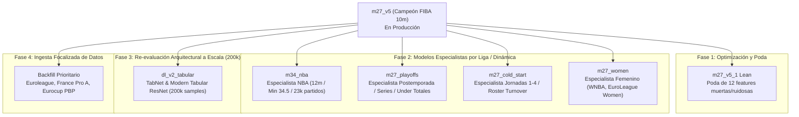

# 🗺️ Roadmap de Modelos Especializados y Próximas Iteraciones (`roadmap.md`)

> **Estado del Sistema:** Producción activa en `m27_v5` (198,423 partidos, Test AUC 0.6708, WR 75.61% en $P \ge 0.68$, ROI @ 1.40: +5.85%).
> **Objetivo:** Desacoplar ligas y situaciones anómalas en **modelos especialistas dedicados** para maximizar el edge estadístico e iterar ordenadamente uno por uno.

---

## 📋 Catálogo de Modelos en el Roadmap

---

## 1. `m27_v5_1` (Poda de Ruido y Modelo Lean)
* **Problema que resuelve:** En `m27_v5` coexisten 37 features seleccionadas, pero tras auditar las importancias de XGBoost e HistGB, entre 10 y 12 features tienen importancia $< 0.005$ o correlaciones irrelevantes con el objetivo. Mantenerlas introduce grados de libertad innecesarios y riesgo de ruido en vivo.
* **Acciones concretas:**
  1. Podar variables con importancia casi nula (`gp_slope_3m`, `fraction_q3_completed`, `h2h_bayes_q4_margin`, `pbp_ft_diff_q1_q3`).
  2. Reducir el vector de entrada a ~25 features compactas de máxima señal ortogonal.
  3. Re-ajustar hiperparámetros de regularización (`colsample_bytree`, `subsample`, `min_child_weight`).
* **Métrica objetivo:** Test AUC $\ge 0.6720$, menor latencia de inferencia ($< 1.2$ ms) y cero sobreajuste.

---

## 2. `m34_nba` (Modelo Especialista NBA 12 Minutos)
* **Problema que resuelve:** La NBA tiene cuartos reglamentarios de **12 minutos**, ritmo extremadamente alto (Pace $> 100$), rotaciones de 10 hombres, alta paridad competitiva y gestión de minutos de estrellas (*load management*). Mezclarla con FIBA 10m diluye la predicción.
* **Dataset dedicado:** 23,415 partidos de NBA limpios y con datos completos de cuartos y PBP.
* **Minuto de disparo óptimo:** **Minuto 34.0 a 35.5** (equivalente al min 27 de FIBA, 90% de Q3 disputado).
* **Features exclusivas del especialista:**
  * `rest_days_diff` y `is_back_to_back`: Impacto severo en Q4 en NBA.
  * `star_clutch_usage`: Uso de posesiones de la superestrella en los últimos 5 minutos.
  * `three_point_variance_rate`: Dependencia del triple moderno NBA.
  * `pace_factor`: Ajuste por velocidad de posesiones.
* **Métrica objetivo:** WR $\ge 72.0\%$ en $P \ge 0.65$ con momios reales de casas de apuestas estadounidenses.

---

## 3. `m27_playoffs` / `m27_finals` (Especialista en Postemporada y Series)
* **Problema que resuelve:** Los partidos de eliminación y series de campeonato se juegan con una dinámica totalmente distinta a la fase regular:
  * Rotaciones recortadas a 7 u 8 jugadores (los titulares juegan 38-42 min).
  * El tanteo promedio colapsa en **-10.3 puntos totales** y **-2.6 puntos en Q4** (tendencia clara a *Under*).
  * La ventaja de localía sube a 63.4% en finales vs 57.6% en regular.
* **Features exclusivas del especialista:**
  * `series_game_number`: Número de partido en la serie (Game 1 a 7).
  * `series_lead_margin`: Estado de la serie (ej. 3-0 vs 3-3).
  * `elimination_pressure_flag`: Si el equipo que pierde queda eliminado.
  * `starters_minutes_concentration`: Concentración de minutos del quinteto titular.
  * `clutch_free_throw_pct`: Precisión desde la línea de tiros libres bajo presión psicológica.
* **Mercados abordados:**
  1. *Q4 Moneyline:* Potenciando el peso de los titulares.
  2. *Q4 / FT Totals (Under):* Captura del colapso del ritmo de juego en partidos decisivos.

---

## 4. `m27_cold_start` (Especialista en Inicios de Temporada & Roster Turnover)
* **Problema que resuelve:** En las primeras 3 a 5 jornadas de una temporada:
  * Los equipos sufren rotación de plantilla (*offseason roster turnover*).
  * Los ratings Elo arrastran la inercia del año previo pero los nuevos jugadores aún no tienen química.
  * Los H2H directos tienen meses de antigüedad.
* **Hallazgo empírico reciente:** Con el filtro de confianza verde $P \ge 0.68$, `m27_v5` logra un **76.76% de Win Rate en Jornadas 1-3** debido a que se vuelve ultra-selectivo (solo dispara en el 12.9% de partidos donde el marcador live confirma la superioridad).
* **Features exclusivas del especialista:**
  * `roster_retention_index`: Porcentaje de minutos jugados la temporada pasada por el plantel actual.
  * `live_in_game_weight_factor`: Mayor ponderación a las estadísticas en vivo del partido y menor a priors históricos.
  * `offseason_days_gap`: Días transcurridos desde el último partido oficial.
  * `confidence_shrinkage_penalty`: Ajuste bayesiano de incertidumbre en las cuotas.

---

## 5. `dl_v2_tabular` (Re-evaluación de Deep Learning a Escala 200k)
* **Problema que resuelve:** El experimento histórico en `v8` (LSTM + Tabular) se evaluó cuando la base de datos sólo contaba con 38,000 partidos, rindiendo por debajo de los árboles de decisión (AUC 0.780 vs 0.857). Con un dataset depurado de **~200,000 partidos profesionales**, las arquitecturas neuronales modernas pueden descubrir representaciones latentes diferentes.
* **Arquitecturas candidatas a benchmarking:**
  1. **TabNet (Google Research):** Mecanismos de atención secuencial para selección de variables tabulares en cada paso de decisión.
  2. **FT-Transformer (Feature Tokenizer Transformer):** Transforma variables numéricas y categóricas en tokens embebidos procesados por capas de multi-head self-attention.
  3. **ResNet-Tabular (Gorishniy et al.):** Perceptrones multicapa profundos con conexiones residuales y normalización por lotes.
  4. **Entity Embeddings de Equipos y Jugadores:** Representaciones vectoriales continuas de 16-32 dimensiones para capturar química y estilos de juego sin dispersión categórica.
* **Criterios de viabilidad para producción:**
  * Debe superar o igualar el AUC de `m27_v5` ($> 0.671$).
  * Latencia en CPU por inferencia inferior a **8 milisegundos** para no comprometer el daemon live de `monitor_v3`.

---

## 6. `m27_women` (Especialista en Ligas Femeninas)
* **Problema que resuelve:** Las ligas femeninas (WNBA, EuroLeague Women, Liga Femenina Endesa, etc.) exhiben una dinámica estadística muy particular:
  * Menor tasa y varianza de triples lanzados que en el básquetbol masculino.
  * Mayor disciplina en el control de rebotes y menor volatilidad en los parciales de rachas.
  * Alta retención de la ventaja al minuto 27 (Win Rate histórico en $P \ge 0.60$ entre **78% y 89%**).
* **Features exclusivas del especialista:**
  * Calibración de umbrales a $P \ge 0.60$.
  * Ratios ajustados de porcentaje de tiro de campo de 2 puntos y eficiencia de posesión.

---

## 7. `backfill_priority` (Plan de Ingesta Focalizada de Partidos Faltantes)
* **Problema que resuelve:** Existen ligas catalogadas como altamente rentables en las que faltan partidos con Play-by-Play (PBP) o cobertura de temporadas pasadas en `matches.db`.
* **Auditoría de Brechas Detectadas (2023–2026):**
  1. **Euroleague:** Faltan ~160 partidos con PBP en 2024 y ~328 en 2025 (la cobertura PBP cayó al 57.7% en 2025).
  2. **France Pro A (LNB Élite):** Faltan ~336 partidos con PBP en 2024 y ~185 en 2025 (cobertura PBP del 46.6% al 64.1%).
  3. **Eurocup:** Faltan ~155 partidos con PBP en 2024 y ~355 en 2025.
  4. **KBL (Corea del Sur):** Cuenta con los marcadores de cuartos, pero casi el 90% de sus partidos carece de Play-by-Play detallado.
  5. **Liga ACB (España) y Serie A (Italia):** Cobertura prácticamente perfecta (**99.5% a 100%**).
* **Plan de Acción:**
  * Configurar scraping/fetch asistido por API móvil con `tools/fetch_range_adb.py` priorizando Euroleague, Eurocup y Pro A para completar el histórico al 100%.

---

## 🗓️ Cronograma de Iteración y Ejecución

| Prioridad | Tarea / Modelo | Alcance | Estado |
| :---: | :--- | :--- | :---: |
| **P1** | **`m27_v5_1` (Lean Pruning)** | Poda de 12 features ruidosas y optimización de ensemble | 🟡 Pendiente |
| **P2** | **`m34_nba` (Especialista 12m)** | Entrenamiento en 23.4k partidos limpios de NBA a min 34.5 | 🟡 Pendiente |
| **P3** | **`backfill_priority` (Euroleague/Pro A)** | Descarga de PBP faltante de temporadas 2024-2025 | 🟡 Pendiente |
| **P4** | **`m27_playoffs`** | Features de serie, rotación acortada y Under Q4 | 🟡 Pendiente |
| **P5** | **`dl_v2_tabular` Benchmark** | TabNet / FT-Transformer en 200k partidos | 🟡 Pendiente |
| **P6** | **`m27_cold_start` / `m27_women`** | Especialistas en inicio de temporada y básquetbol femenino | 🟡 Pendiente |
